# Multi-Parametric Retinal Diagnostics: reproduction, audit and improvement

[](https://github.com/Harsh-jain12/retinal-oct-physics-ml/actions/workflows/smoke.yml)

## Team and credits

| Member | |
|---|---|
| Dhvani Shah | |
| Tapnanshu Gandhi | |
| Tanushka Sonde | original repository (v1–v4) |
| Rathod Sai Tejashwini | |

IIT Gandhinagar · NDT course project.

- **Built on** Tanushka Sonde's original repository, [Tanushka-Sonde/Multi-Parametric-Retinal-Diagnostics](https://github.com/Tanushka-Sonde/Multi-Parametric-Retinal-Diagnostics). Its full git history is kept here, so every original commit stays credited.
- **Original paper:** R. Banerjee, S. Sarkar, P. Munshi, *Multi-Parametric Retinal Diagnostics: A Deterministic Physics-Based Engine for Tomographic Classification*, IIT Gandhinagar. PDF: [`paper/Banerjee_Sarkar_Munshi_2025.pdf`](paper/Banerjee_Sarkar_Munshi_2025.pdf).
- **KT-1 reference:** P. Athe, S. Shakya, P. Munshi, A. Luke, D. Mewes, *Characterization of multiphase flow in bubble columns using KT-1 signature and fractal dimension*, Flow Meas. Instrum. 33, 122–137, 2013. PDF: [`paper/Athe_et_al_2013_KT1_fractal.pdf`](paper/Athe_et_al_2013_KT1_fractal.pdf).
- License: [MIT](LICENSE).

---

This repository reproduces, stress-tests and extends

> R. Banerjee, S. Sarkar, P. Munshi, *"Multi-Parametric Retinal Diagnostics: A Deterministic Physics-Based Engine for Tomographic Classification"*, IIT Gandhinagar.

The paper classifies retinal OCT scans (Normal, CSR, DR, Macular Hole) using two "physics" numbers per image patch: a **KT-1 density slope S** and a **Hurst roughness exponent H**. It reports 71% accuracy and a perfect 100% Normal-vs-disease triage.

The work happened in five stages:

| Stage | What was done | Main finding |
|---|---|---|
| **v1** Reproduce | Re-implemented the paper exactly | Numbers reproduce (68–73% accuracy, NORMAL 41/41) |
| **Audit** | Checked *why* it works | The 100% triage is a **scanner confound**: Normal scans come from a different machine |
| **v2** Anatomy | Find the retinal layers, measure inside them | Balanced accuracy on the honest disease-only task goes from **0.50 → 0.84** |
| **v3/v4** NDT + fractal | Pulse-echo (ultrasound-style) features, boundary "coastline" fractals | Small further gains (**0.86–0.87**), detection limits measured (MAPOD) |
| **v5** ROM + ML | Reduced-order modelling (POD), ensembles, conformal guarantees, scanner calibration | POD explains *why* the paper's grid fails. The ensemble is the best model on Kermany and on the unseen scanner. Triage gets a real, stated guarantee |
| **v6** Image-level ROM + hybrid | POD of the flattened *image*, healthy-only POD residual (defect detection), frozen deep features + physics, ablation, Grad-CAM check | The ResNet-18 hybrid is significantly better than v5 on OCTID, OCTDL 7-class, Kermany 4-class, Kermany 3-disease, the new scanner, not on OCTDL 6-disease; physics adds accuracy over the embedding alone on OCTDL 7-class and Kermany. The fine-tuned CNN stays ahead, clearly so on a new scanner |

v6 (image-level ROM, hybrid deep + physics model) is in [Section 11](#11-v6-image-level-rom-and-a-hybrid-model), summarised in [`results/v6/SUMMARY.md`](results/v6/SUMMARY.md). A presentation deck that explains the whole project is in [Section 12](#12-presentation).

---

## Contents
1. [Progress at a glance](#1-progress-at-a-glance)
2. [Quick start](#2-quick-start)
3. [Background: OCT and the three datasets](#3-background-oct-and-the-three-datasets)
4. [The paper's method, explained](#4-the-papers-method-explained)
5. [v1: reproduction](#5-v1-reproduction)
6. [What the data can and cannot show (the confound)](#6-what-the-data-can-and-cannot-show-the-confound)
7. [v2: anatomy-aware features](#7-v2-anatomy-aware-features)
8. [v3: NDT (pulse-echo) features and MAPOD](#8-v3-ndt-pulse-echo-features-and-mapod)
9. [v4: fractal validation and boundary fractals](#9-v4-fractal-validation-and-boundary-fractals)
10. [v5: reduced-order modelling and machine learning](#10-v5-reduced-order-modelling-and-machine-learning)
11. [v6: image-level ROM and a hybrid model](#11-v6-image-level-rom-and-a-hybrid-model)
12. [Presentation](#12-presentation)
13. [How we evaluate (and why)](#13-how-we-evaluate-and-why)
14. [Code map](#14-code-map)
15. [Limitations and next steps](#15-limitations-and-next-steps)
16. [Glossary](#16-glossary)
17. [References](#17-references)

---

## 1. Progress at a glance

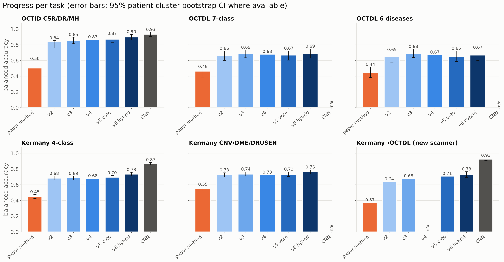

Best **balanced accuracy** (patient-grouped 5-fold CV, mean of 3 repeats). Chance is 1/(number of classes).

| Task (chance) | Paper method | v2 | v3 | v4 | v5 ensemble | **v6 hybrid (ResNet-18)** | CNN (black box) |
|---|---|---|---|---|---|---|---|
| OCTID CSR / DR / MH, 500×750 only (0.33) | 0.504 | 0.836 | 0.855 | 0.868 | 0.872 | **0.904** | 0.935 |
| OCTDL 7-class (0.14) | 0.464 | 0.661 | 0.689 | 0.682 | 0.669 (LR alone 0.682) | **0.708** | n/a |
| Kermany 4-class (0.25) | 0.449 | 0.683 | 0.692 | 0.680 | 0.695 | **0.730** | 0.867 |
| Kermany → OCTDL, unseen scanner (0.33) | 0.374 | 0.640 | 0.680 | n/a | 0.702 | **0.753** | 0.925 |

*Every cell is the best row of that stage's result file (`results/v5/progress.json` for the first three rows; `results/v2|v3/cross_scanner.json` and `results/v5/harmonize.json` for the last). v4 adds fractal features on top of v3, so a v4 cell can be slightly below v3 when the fractal features add nothing. v6 hybrid: `results/v6/hybrid_<task>.json`, ResNet-18 hybrid (the headline model; the DINOv2-S hybrid was pre-registered before the results, ResNet-18 was chosen afterwards because it wins or ties on 4 of 6 tasks, and both are reported in Section 11). CNN: `results/v6/cnn_<task>.json`, fine-tuned ResNet-18 re-run on the *same* folds as every other model so the comparison is paired (the earlier `cnn_baseline.py` runs gave 0.940 / 0.864 / 0.932); not run on OCTDL to stay inside the GPU budget.*

**Bottom line.**
- The *physics idea* (measure roughness and density) works much better once it is measured **inside anatomical layers** (v2). The paper's fixed pixel grid is the main weakness, and v5's POD analysis shows why: most of its variation is *where the retina sits in the picture*, not disease.
- Better ML on top of good features adds a little within one scanner (+0.00 to +0.02) and most on the hardest test, an unseen scanner (+0.022 over the previous best).
- v6 adds frozen deep features (ResNet-18) to the physics. Paired against v5, the gain is significant on OCTID, OCTDL 7-class, Kermany 4-class, Kermany 3-disease, the new scanner (e.g. Kermany 4-class +0.032 [+0.018, +0.045], p = 0.000) and the CI includes zero on OCTDL 6-disease (+0.028 [-0.007, +0.059], p = 0.051). A fine-tuned CNN remains better: by 0.036 on OCTID (CI includes zero), 0.141 on Kermany and 0.172 on a new scanner.

---

## 2. Quick start

```bash
python -m venv .venv
source .venv/bin/activate            # Windows: .venv\Scripts\activate
pip install -r requirements.txt
```

**No images needed for v5.** Every v5 script reads the per-scan feature tables already committed in `results/v4/`:

| Command | Time (2 CPU cores) | Output |
|---|---|---|
| `python v5_rom.py` | ~3 min | `results/v5/rom.json`, `rom_*.png` |
| `python v5_ensemble.py` | ~25 min | `results/v5/ensemble.json`, `ensemble.md` |
| `python v5_conformal.py` | ~10 min | `results/v5/conformal.json` |
| `python v5_harmonize.py` | ~3 min | `results/v5/harmonize.json` |
| `python v5_summary.py` | seconds | `results/v5/progress.png`, `progress.json` |

**v6 needs the images** (it works on the flattened image, not on the feature tables). After downloading (below):

| Command | Time (8-core laptop, 8 GB) | Output |
|---|---|---|
| `python v6_tiles.py octid octdl kermany` | ~2 min | flattened 128×512 tiles, `data/cache/v6/` |
| `python v6_embed.py octid octdl kermany` | ~5 min (Apple GPU) | frozen ResNet-18 / DINOv2-S embeddings |
| `python v6_image_pod.py` | ~40 min | Step 1, `results/v6/image_pod_*.json` |
| `python v6_residual.py` | ~60 min | Step 2, `residual_*.json` |
| `python v6_cnn.py --task octid_dis750` (also `kermany_4`, `cross`) | 6 / 50 / 7 min (GPU) | CNN on the same folds, fold models for Grad-CAM |
| `python v6_hybrid.py` (importance: `--task importance --backbone resnet18`/`dinov2s`) | ~60 min | Step 3, `hybrid_*.json`, `hybrid_importance*.json` |
| `python v6_ablation.py` | ~2 min | paired hybrid vs embedding-only / v5 / CNN, `ablation.json` |
| `python v6_gradcam.py` | ~5 min | Step 4, `gradcam_octid_dis750.json` |
| `python v6_tiles.py octdl --blur 0.5 1 --features` then `python v6_embed.py octdl --blur 0.5 1` and `python v6_cross.py` | ~25 min | Step 5, `cross.json` |
| `python v6_conformal.py` (`--backbone dinov2s` for the DINOv2 hybrid) | ~40 min | Step 6, `conformal.json` |
| `python v6_baselines.py`, `python v6_figdata.py`, `python v6_paper_claims.py`, `python v6_summary.py` | minutes | figure inputs, `SUMMARY.md` |

Every v6 script takes `--quick` (1 seed, 2 folds) for a smoke test. `pytest tests/` checks that no transformer is ever fitted on test rows.

**To recompute features from images (v1–v4)** you need the datasets:

```bash
python download_data.py                        # OCTID (~35 MB, the paper's dataset)
python download_data.py octdl                  # OCTDL (~400 MB, Zenodo)
python download_data.py kermany                # Kermany OCT2017 (~6 GB)
python make_manifest.py octid                  # also: kermany --per-class 600, octdl
```

| Stage | Commands | Output |
|---|---|---|
| v1 paper | `extract_features.py`, `train_eval.py`, `sanity_checks.py`, `harmonized_experiment.py` | `results/` |
| v2 | `extract_v2.py`, `evaluate_v2.py`, `analysis_v2.py`, `controls_octid.py`, `cross_scanner.py`, `cnn_baseline.py` | `results/v2/` |
| v3 | `extract_ndt.py`, `ndt_checks.py`, `ndt_paired_test.py`, `ndt_importance.py`, `mapod.py`, `mapod_sweep.py` | `results/v3/` |
| v4 | `extract_fractal.py`, `fractal_validation.py`, `fractal_eval.py` | `results/v4/` |

---

## 3. Background: OCT and the three datasets

**OCT (Optical Coherence Tomography)** is ultrasound with light. A beam is sent into the eye and the *echo delay* of back-scattered light gives depth. One depth profile is an **A-scan**; sweeping sideways gives a 2-D cross-section, the **B-scan**, which is what every image here is. Bright = strongly reflecting tissue.

```
 vitreous (dark gel)
 ───────────── ILM  (inner limiting membrane: top surface of retina)
   inner retina (nerve fibre, ganglion, plexiform layers)
   outer retina (photoreceptors)
 ═════════════ RPE  (retinal pigment epithelium: brightest line, the "back wall")
   choroid (blood vessels)
```

Diseases in this repo, in one line each:

| Code | Disease | What it looks like on OCT |
|---|---|---|
| CSR | Central serous retinopathy | Dark fluid blister *under* the retina, on top of the RPE |
| DR / DME | Diabetic retinopathy / macular oedema | Dark cysts *inside* the retina, bright spots, thickening |
| MH | Macular hole | A gap through the full retina at the fovea |
| AMD / CNV / DRUSEN | Age-related macular degeneration | Bumpy or lifted RPE, new vessels, deposits under the RPE |
| ERM | Epiretinal membrane | Wrinkled, pulled ILM surface |
| RAO / RVO | Retinal artery / vein occlusion | Thick, bright (RAO) or swollen, cystic (RVO) inner retina |
| VID | Vitreo-macular interface disease | Traction at the vitreous–retina surface |

| Dataset | Scanner | Scans used | Classes | Patient IDs? |
|---|---|---|---|---|
| **OCTID** (paper's) | Zeiss Cirrus (exported JPEGs) | 517 | NORMAL 206, CSR 102, DR 107, MH 102 | No (each image = its own group) |
| **Kermany OCT2017** | Heidelberg Spectralis | 2401 (600/class subset) | NORMAL, CNV, DME, DRUSEN | Yes |
| **OCTDL** | Optovue RTVue | 2064 | NORMAL, AMD, DME, ERM, RAO, RVO, VID | Yes |

Kermany and OCTDL were added because OCTID is small and confounded (Section 6), and because two different scanners allow a train-on-one, test-on-another check.

---

## 4. The paper's method, explained

### 4.1 Pre-processing (`retina/preprocess.py`)
1. Mask near-white pixels ($I \ge 240$, acquisition wedges) and crop to the bounding box of the rest.
2. Crop symmetrically to the aspect ratio $750/500 = 1.5$, then resize (cubic) to **750 × 500**.
3. Cut into a **15 × 10 grid of 50 × 50 px cells** $g_{i,j}$: 150 cells, `grid id = row·15 + col`.

### 4.2 Feature 1: KT-1 slope S ("tissue density")
From Munshi's tomographic error theory: if you blur an image with filters of increasing width, the peak value $N_{\max}$ drops in a way that depends on the material. For each cell:

$$
\text{blur with Gaussians } \sigma \in \{3, 2, 1, 0.1\}, \qquad
N_{\max}(\sigma) = 99^{\text{th}}\text{ percentile of the blurred cell}
$$

$$
S_{\text{KT-1}} = \text{slope of the straight-line fit of } \frac{1}{N_{\max}} \text{ against } |W''(0)| \propto \sigma^2
$$

(For a Gaussian window $W(\xi) = e^{-2\pi^2\sigma^2\xi^2}$, the second derivative at the origin is $|W''(0)| = 4\pi^2\sigma^2$. Only proportionality matters.)

### 4.3 Feature 2: Hurst exponent H ("roughness")
Treat the cell as a landscape whose height is brightness. For fractional-Brownian-motion-like texture, brightness differences grow as a power of distance:

$$
\text{NMSID}(k) = \frac{1}{N_k}\sum_{\text{pairs at distance }k} |I(x_2,y_2) - I(x_1,y_1)|, \qquad
\log \text{NMSID}(k) = H \log k + C
$$

$H$ is the slope on a log–log plot (here $k = 1 \dots 25$). Small $H$ = rough, jagged texture; $H \to 1$ = smooth. The fractal dimension of the intensity surface is $D = 3 - H$.

### 4.4 Classifier
300 features per scan (150 cells × {H, S}) go into a **Random Forest**: 300 trees, `max_depth = 12`, `min_samples_leaf = 2`, `class_weight = "balanced"`, stratified 80/20 split (104 test scans).

A random forest averages many decision trees, each trained on a bootstrap resample of the scans with a random subset of features at every split. *Balanced* class weights scale the loss of class $k$ by $n/(K\,n_k)$, so small classes count as much as big ones.

---

## 5. v1: reproduction

| Metric | Paper | This repo |
|---|---|---|
| Test set | 104 (CSR 21 / DR 22 / MH 20 / N 41) | identical |
| NORMAL precision / recall | 1.00 / 1.00 | **1.00 / 1.00** (41/41) |
| Overall accuracy (80/20 split) | 71% | **68.3%** |
| Overall accuracy (5-fold × 10 CV) | n/a | **72.9 ± 3.4%** (range 65–79%) |
| Top-15 features that are Hurst | 15/15 | **15/15** |
| Location of top-15 cells | rows 7–8 (grids 106–133) | **rows 7–8** |

Choices the paper leaves open: intensity scale [0, 1]; $W''(0) \propto \sigma^2$; NMSID range $k = 1\dots25$; background cells get $N_{\max}$ floored at 0.05 and $H = 0$; the Fig. 4 phase plot uses per-scan mean H vs mean S.

**The paper's numbers reproduce.** The next question is what they mean.

---

## 6. What the data can and cannot show (the confound)

In OCTID, Normal and disease scans were exported from **different devices/protocols**:

| Original size | CSR | DR | MH | NORMAL |
|---|---|---|---|---|
| 500×750 | 68 | 102 | 102 | 0 |
| 586×879 | 34 | 5 | 0 | 0 |
| 496×512, 512×512, 496×768, 496×1024, 496×1536 | 0 | 0 | 0 | 206 |

Normal files are also all `.jpg`, disease files all `.jpeg`. Findings (`sanity_checks.py`, `harmonized_experiment.py`, `controls_octid.py`):

1. **Image size alone** separates Normal from disease with **100%** accuracy.
2. **Resampling drives H.** Step 2 upsamples Normal scans ≈ 1.32× and disease scans ≈ 1.0×. Cubic upsampling smooths texture and raises H (Spearman ρ = 0.82 between upsampling factor and mean H).
3. **Resampling flips the model.** Shrink the 63 held-out disease scans to 512 px wide and the trained model calls **63/63 of them NORMAL** (before: 0/63).
4. **Plain statistics do as well.** Per-cell mean and standard deviation of brightness give 77.7% CV accuracy and Normal P/R 0.98/0.99.
5. **"Autonomous localisation" is partly position.** Rows 7–8 matter mostly for Normal-vs-disease (row-8 permutation importance 0.198 with all classes, 0.069 disease-only). Sorting each scan's 150 values (destroying location) *raises* disease-only accuracy from 0.55 to 0.61.

So **OCTID cannot validate Normal-vs-disease triage**. The honest OCTID task is **CSR vs DR vs MH using only the 500×750 scans** (one export format). The paper's method scores **0.50 balanced accuracy** there (chance 0.33). That is the baseline every later stage tries to beat.

---

## 7. v2: anatomy-aware features

*Code: `retina/layers.py`, `retina/features_v2.py`.* The idea: keep the physics measurements but take them **in the same tissue in every scan**.

**Flattening.** Resample to a common axial scale (3.87 µm/px), trace the RPE (brightest ridge) and ILM (first strong rise below the vitreous) column by column, fit a robust quadratic to the RPE, and shift every column so the RPE becomes a straight line at row 200. Now "row r" means the same depth above the RPE in every scan.

**Regions.** 4 depth **bands** (inner retina, outer retina, RPE, choroid) × 5 lateral **sectors** centred on the fovea (peri-L, para-L, central, para-R, peri-R) = 20 regions.

**11 texture numbers per region** (220 total):

| Feature | Formula / meaning |
|---|---|
| `H`, `H_r2` | Hurst slope of masked NMSID ($k = 1\dots8$) and the $R^2$ of its log–log fit |
| `nmsid1`, `nmsid_ratio` | Roughness at $k = 1$; curve shape $\text{NMSID}(8)/\text{NMSID}(1)$ |
| `lac4`, `lac8` | Lacunarity (gappiness) $\Lambda(r) = \dfrac{\mathbb{E}[M_r^2]}{\mathbb{E}[M_r]^2}$, $M_r$ = box sum at box size $r$ |
| `entropy` | Shannon entropy $-\sum_b p_b \log p_b$ of a 32-bin histogram |
| `mean`, `std` | Reflectivity statistics |
| `kt1` | The paper's KT-1 slope |
| `coh` | Structure-tensor **coherence** $\dfrac{\lambda_1 - \lambda_2}{\lambda_1 + \lambda_2}$ (0 = isotropic, 1 = perfectly layered). This is the paper's own "anisotropic coherence tensor" future work |

**23 disease-specific numbers:** thickness profile (central, mean, asymmetry), foveal dip depth, full-thickness gap columns (macular hole), dark-pocket fluid fraction (CSR/DME), hyper-reflective foci, RPE elevation and bumps (AMD), segmentation QC.

**Result.** On OCTID CSR/DR/MH (500×750) balanced accuracy goes from **0.504 → 0.836** (LR, band-summary + disease, 111 features). The same features carry over to Kermany (0.683) and OCTDL (0.661). Restoring Shannon entropy *improves* the paper's own features (OCTID 4-class: 0.694 → 0.722, best model), so the collinearity argument for discarding it (paper Sec. 3.3) does not hold up.

---

## 8. v3: NDT (pulse-echo) features and MAPOD

*Code: `retina/features_ndt.py`, `mapod.py`.* OCT is optical pulse-echo testing, so ultrasonic NDT tools apply. Everything is normalised to references inside the same image (vitreous = noise floor, RPE = back-wall echo, $D$ = RPE − vitreous):

| Family | NDT analogue | Formula |
|---|---|---|
| `att_*` | Attenuation | Beer–Lambert $I(z) = I_0 e^{-2\mu z}$ is linear on a log display, so depth slope / $D$ ∝ $\mu$ |
| `ic_*` | Interface reflection | Michelson contrast $(a-b)/(a+b)$ at the ILM and RPE |
| `hm_*` | 6 dB-drop sizing | Defect edge where the echo falls halfway between tissue and vitreous |
| `sh_*` | Shadowing | Choroid signal loss under a column vs a running baseline |
| `cnr_*` | Detectability | $\text{CNR} = \lvert\mu_a - \mu_b\rvert / \sigma$ |
| `spk_*` | Speckle | Nakagami $m = \mathbb{E}[I^2]^2 / \text{Var}(I^2)$, speckle contrast $\sigma/\mu$ |

Eight NDT features differ strongly between healthy eyes of different scanners ($|d| > 0.8$); the "NDT robust" set drops them.

**Result.** Adding NDT gives +0.011 to +0.034 balanced accuracy on OCTID CSR/DR/MH (paired test, p = 0.01–0.06), reaching **0.855**.

**MAPOD** (model-assisted probability of detection, MIL-HDBK-1823A style): synthetic fluid pockets of known height $a$ are painted into healthy scans and the detector is scored hit/miss. Then

$$
\text{POD}(a) = \Phi\!\left(\frac{\ln a - \mu}{\sigma}\right),
$$

fitted by maximum likelihood. $a_{90/95}$ is the size detected 90% of the time with 95% confidence. Subretinal (CSR-like) fluid: $a_{90} \approx 52$–$57$ µm. Intraretinal cysts: $a_{90} \approx 45$–$61$ µm (display-round) or 123–139 µm (round in µm, using the assumed lateral spacing).

---

## 9. v4: fractal validation and boundary fractals

*Code: `retina/fractal.py`, `fractal_validation.py`, `fractal_eval.py`.*

**Are the estimators right?** They were tested on shapes with known dimension:

| Test shape | True | Measured |
|---|---|---|
| Sierpinski carpet (box counting) | D = 1.893 | 1.893 |
| Koch curve (divider / box) | D = 1.262 | 1.267 / 1.293 |
| Plane, 2-D NMSID | H = 1 | 0.965 |
| fBm profile, H = 0.5 | 0.5 | 0.506 |
| **Paper's 50×50 grid estimator**, fBm surface H = 0.1 | 0.1 | **0.22 ± 0.04** |
| same, after the paper's 1.32× upsampling | 0.1 | 0.26 ± 0.05 |

The paper's estimator is **biased upward at low H** and upsampling adds more bias, which is the mechanism behind the confound in Section 6.

**Coastline fractals.** The ILM and RPE are curves. Their roughness is measured scale-free (profile Hurst $\mathbb{E}|z(x+d) - z(x)| \sim d^H$, $D = 2 - H$; and divider length $L(r) \sim r^{1-D}$). Adding them gives +0.020 (LR) on OCTID CSR/DR/MH (p = 0.065) and nothing on OCTDL/Kermany: **0.868** best.

---

## 10. v5: reduced-order modelling and machine learning

New code: `retina/rom.py`, `retina/ensemble.py`, `retina/conformal.py` and scripts `v5_*.py`. All results in `results/v5/`.

### 10.1 Reduced-order modelling with POD

**Idea (from fluid mechanics).** A flow field sampled at thousands of mesh points is usually described well by a handful of shapes ("modes"). The paper's features are also *fields*: an H map and an S map on a 10×15 grid. If we find the few dominant modes, we get (a) compression and (b) an interpretable picture of what varies between scans.

**Proper Orthogonal Decomposition (POD) in five lines.** Stack the $n$ scans' fields (each flattened to $m$ cells) as rows of a matrix:

$$
A = \begin{bmatrix} (x_1 - \bar x)^T \\ \vdots \\ (x_n - \bar x)^T \end{bmatrix} \in \mathbb{R}^{n\times m}, \qquad
A = U\Sigma V^T \;\;(\text{SVD})
$$

$$
\text{mode } j:\; \phi_j = V_{:,j}, \qquad
\text{energy: } E(r) = \frac{\sum_{j\le r}\sigma_j^2}{\sum_j \sigma_j^2}, \qquad
\text{coordinates: } a = V_r^T(x - \bar x), \qquad
\hat x = \bar x + V_r a
$$

POD is the same mathematics as PCA. The ROM vocabulary (snapshots, modes, energy) is used because the modes are *spatial fields* we can look at. In every classification experiment `FieldPOD` is fitted **inside the training fold only**.

**Finding 1: the paper's grid is poorly compressible; anatomy-aligned fields are not.**

| Field | Cells $m$ | Modes for 95% energy (OCTID / OCTDL / Kermany) |
|---|---|---|
| Paper H field (fixed pixel grid) | 150 | 44 / 72 / 57 |
| Paper S field | 150 | 35 / 44 / 51 |
| v2 H field (band × sector, flattened retina) | 20 | 13 / 15 / 14 |

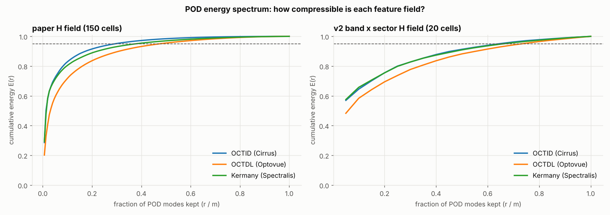

**Finding 2: the dominant modes are geometry, not disease.**

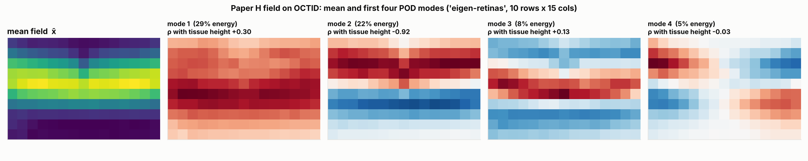

Mode 1 is a uniform shift (overall roughness level). **Mode 2 is a top/bottom dipole whose coefficient correlates with the retina's vertical position at ρ = −0.92.** Mode 3 is a thickness (three-band) pattern and mode 4 a left/right tilt. This is the textbook POD signature of a *translating* structure, the well-known weakness of POD for transport problems. The paper's grid does not move with the retina, so most of its variance describes where the retina sits in the picture.

**Finding 3: energy ≠ information.** For every mode we measured the class signal of its coefficient (Kruskal–Wallis $\varepsilon^2$) on the disease-only tasks. The rank correlation between a mode's energy and its class signal is −0.18 (OCTID) and +0.12 (Kermany): **no relationship**. The most discriminative mode is #33 on OCTID.

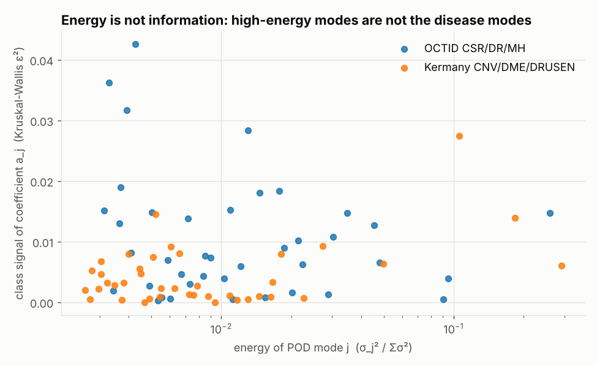

**Finding 4: accuracy vs number of modes.**

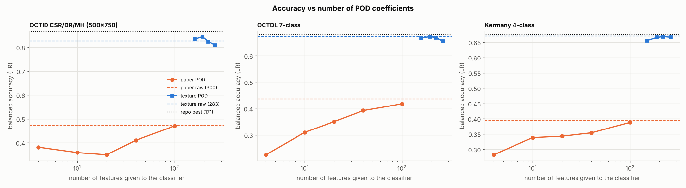

| Task | Paper raw (300) | Paper POD, r = 50/field (100) | v2 texture raw + scalars (283) | v2 texture POD 90% + scalars | Repo best (171) |
|---|---|---|---|---|---|
| OCTID CSR/DR/MH | 0.472 | 0.471 | 0.826 | **0.845** (192) | 0.868 |
| OCTDL 7-class | 0.436 | 0.418 | 0.673 | 0.672 (195) | 0.682 |
| Kermany 4-class | 0.394 | 0.388 | 0.670 | 0.666 (187) | 0.677 |

(LR classifier. Number of features in brackets. The 83 scalar features are passed through, so at 90% energy POD compresses the 200 texture values to 104–112 coefficients at no loss.)

**ROM verdict.** POD does **not** rescue the paper's features: no number of modes, and no choice of the most discriminative modes, beats the raw grid, which is itself weak. POD on the *aligned* texture fields compresses them by about half with no accuracy loss. The lesson: **ROM needs a consistent coordinate frame** (like a fixed CFD mesh). That is why the v6 plan applies POD to the RPE-flattened *image*, where the frame is anatomical.

### 10.2 Soft-voting ensemble

Three different learners on the same 171 features (`v2 band-summary + disease + NDT robust + fractal`):

| Model | How it draws the boundary |
|---|---|
| Logistic regression | Linear: $p(k\mid x) = \dfrac{e^{w_k^T x}}{\sum_j e^{w_j^T x}}$, L2 penalty $C = 0.1$ |
| LightGBM | Sum of 300 small trees, each fitted to the previous trees' errors (gradient boosting) |
| RBF-SVM | Smooth kernel boundary, $K(x, x') = e^{-\gamma\lVert x - x'\rVert^2}$, Platt-scaled probabilities |

Soft vote: $\;\hat p(k\mid x) = \tfrac{1}{3}\sum_m \hat p_m(k\mid x)$, $\;\hat y = \arg\max_k \hat p(k\mid x)$. Members that err differently partly cancel. Before this, a sweep of $C \in \{0.01, \dots, 1\}$ confirmed the repo's $C = 0.1$ is already near-optimal, so tuning was not the bottleneck.

| Task (n) | Model | Balanced acc [95% CI] | Accuracy | Macro-F1 |
|---|---|---|---|---|
| OCTID CSR/DR/MH (500x750) (272) | Logistic regression | 0.868 [0.828, 0.905] | 0.863 | 0.865 |
| OCTID CSR/DR/MH (500x750) (272) | LightGBM | 0.838 [0.788, 0.876] | 0.835 | 0.835 |
| OCTID CSR/DR/MH (500x750) (272) | Soft vote (LR+GBM+SVM) | **0.872** [0.833, 0.911] | 0.868 | 0.869 |
| OCTID 4-class (scanner-confounded) (517) | Logistic regression | 0.843 [0.818, 0.886] | 0.864 | 0.840 |
| OCTID 4-class (scanner-confounded) (517) | LightGBM | 0.864 [0.818, 0.887] | 0.890 | 0.866 |
| OCTID 4-class (scanner-confounded) (517) | Soft vote (LR+GBM+SVM) | **0.870** [0.840, 0.902] | 0.890 | 0.869 |
| OCTDL 7-class (2064) | Logistic regression | **0.682** [0.639, 0.734] | 0.753 | 0.617 |
| OCTDL 7-class (2064) | LightGBM | 0.644 [0.588, 0.690] | 0.834 | 0.693 |
| OCTDL 7-class (2064) | Soft vote (LR+GBM+SVM) | 0.669 [0.605, 0.723] | 0.834 | 0.699 |
| OCTDL 6 diseases (1732) | Logistic regression | **0.674** [0.632, 0.737] | 0.764 | 0.601 |
| OCTDL 6 diseases (1732) | LightGBM | 0.615 [0.529, 0.657] | 0.845 | 0.675 |
| OCTDL 6 diseases (1732) | Soft vote (LR+GBM+SVM) | 0.653 [0.589, 0.722] | 0.852 | 0.688 |
| Kermany 4-class (2401) | Logistic regression | 0.677 [0.658, 0.702] | 0.677 | 0.676 |
| Kermany 4-class (2401) | LightGBM | 0.680 [0.659, 0.706] | 0.680 | 0.679 |
| Kermany 4-class (2401) | Soft vote (LR+GBM+SVM) | **0.695** [0.671, 0.718] | 0.696 | 0.694 |
| Kermany CNV/DME/DRUSEN (1799) | Logistic regression | 0.708 [0.682, 0.736] | 0.708 | 0.708 |
| Kermany CNV/DME/DRUSEN (1799) | LightGBM | 0.726 [0.700, 0.758] | 0.726 | 0.726 |
| Kermany CNV/DME/DRUSEN (1799) | Soft vote (LR+GBM+SVM) | **0.731** [0.706, 0.765] | 0.731 | 0.731 |

Paired difference *vote − best single model* (same folds, patient bootstrap):

| Task | Best single | Δ balanced acc [95% CI] | one-sided p |
|---|---|---|---|
| OCTID CSR/DR/MH (500x750) | Logistic regression | +0.004 [-0.025, +0.037] | 0.359 |
| OCTID 4-class (scanner-confounded) | LightGBM | +0.005 [-0.005, +0.043] | 0.064 |
| OCTDL 7-class | Logistic regression | -0.013 [-0.047, +0.008] | 0.912 |
| OCTDL 6 diseases | Logistic regression | -0.021 [-0.064, -0.002] | 0.982 |
| Kermany 4-class | LightGBM | +0.015 [-0.001, +0.023] | 0.036 |
| Kermany CNV/DME/DRUSEN | LightGBM | +0.005 [-0.009, +0.020] | 0.175 |

**Reading.** The ensemble gives the best balanced accuracy on Kermany and on OCTID (where the gain is within noise), and the best (or tied-best) accuracy and macro-F1 on every task. On OCTDL, plain LR keeps the best *balanced* accuracy, because OCTDL has very small classes (RAO, RVO, VID) that the tree models under-call. Across scanners (Kermany → OCTDL, Section 10.4) the ensemble is the best model.

### 10.3 Conformal triage: a guarantee that actually holds

The paper claims triage that is "mathematically guaranteed". A classifier score cannot guarantee anything. **Conformal prediction** can, under one stated assumption (new scans are exchangeable with the calibration scans, i.e. same scanner and population).

**Class-conditional split conformal** (`retina/conformal.py`):
1. Split training patients into *fit* (75%) and *calibration* (25%). Fit the model on *fit*.
2. Score each calibration scan: $s_i = 1 - \hat p(y_i \mid x_i)$ (how "surprised" the model is by the truth).
3. For each class $k$ with $n_k$ calibration scans, set $q_k$ = the $\lceil (n_k + 1)(1-\alpha) \rceil$-th smallest score of class $k$.
4. Prediction **set** for a new scan: $C(x) = \{\,k : 1 - \hat p(k\mid x) \le q_k\,\}$.

Then $P(y \in C(x) \mid y = k) \ge 1 - \alpha$ **for every class** $k$. For triage this bounds the miss rate for diseased eyes: a scan is cleared as healthy only if $C(x) = \{\text{NORMAL}\}$.

| Task | Target 1−α | Coverage per class | Mean set size | Singleton rate | Singleton accuracy |
|---|---|---|---|---|---|
| OCTDL triage NORMAL vs ABNORMAL | 0.95 | ABNORMAL 0.955, NORMAL 0.959 | 1.08 | 0.92 | 0.952 |
| OCTDL triage NORMAL vs ABNORMAL | 0.90 | ABNORMAL 0.903, NORMAL 0.905 | 0.98 | 0.96 | 0.931 |
| Kermany triage NORMAL vs ABNORMAL | 0.95 | ABNORMAL 0.943, NORMAL 0.939 | 1.27 | 0.73 | 0.921 |
| Kermany triage NORMAL vs ABNORMAL | 0.90 | ABNORMAL 0.890, NORMAL 0.885 | 1.09 | 0.91 | 0.878 |
| OCTID CSR/DR/MH (500x750) | 0.95 | CSR 1.000, DR 0.956, MH 0.951 | 2.10 | 0.18 | 0.948 |
| OCTID CSR/DR/MH (500x750) | 0.90 | CSR 0.934, DR 0.926, MH 0.907 | 1.25 | 0.75 | 0.910 |
| Kermany CNV/DME/DRUSEN | 0.95 | CNV 0.944, DME 0.957, DRUSEN 0.946 | 1.82 | 0.33 | 0.899 |
| Kermany CNV/DME/DRUSEN | 0.90 | CNV 0.892, DME 0.915, DRUSEN 0.873 | 1.53 | 0.52 | 0.841 |

Coverage lands on or within 0.03 of target for every class. It sits slightly under on Kermany (e.g. DRUSEN 0.873 at target 0.90), whose patients contribute up to 3 correlated images each, so exchangeability is only approximate there. "Singletons" are scans where the model commits to one label; at α = 0.05 those are right 92–95% of the time in triage. Ambiguous scans get two labels and should go to a clinician. **This is the defensible version of the paper's triage claim**, demonstrated on single-scanner data (OCTDL, Kermany), not on the confounded OCTID split.

### 10.4 Scanner harmonisation ("calibration block")

Train on Kermany (Spectralis), test on OCTDL (Optovue), labels NORMAL / DME / AMD. Calibration per feature: $z = (x - \mu)/\text{sd}$, with $\mu$, sd taken from

- **z-all**: all scans of that scanner (needs the whole test batch), or
- **healthy-ref (k)**: $k$ healthy eyes of that scanner, like an NDT reference block. These calibration patients are removed from the test set.

| Features | Model | none | z-all | healthy-ref k=10 | k=30 | k=100 |
|---|---|---|---|---|---|---|
| v2 band-summary + disease + NDT | Logistic regression | 0.677 | 0.643 | 0.636 ± 0.034 | 0.652 ± 0.014 | 0.631 ± 0.027 |
| v2 band-summary + disease + NDT | LightGBM | 0.660 | 0.689 | 0.662 ± 0.023 | 0.677 ± 0.014 | 0.690 ± 0.026 |
| v2 band-summary + disease + NDT | Soft vote (LR+GBM+SVM) | 0.702 | 0.701 | 0.672 ± 0.029 | 0.678 ± 0.010 | 0.674 ± 0.041 |
| v2 band-summary + disease + NDT robust + fractal | Logistic regression | 0.671 | 0.655 | 0.617 ± 0.026 | 0.639 ± 0.019 | 0.654 ± 0.033 |
| v2 band-summary + disease + NDT robust + fractal | LightGBM | 0.670 | 0.697 | 0.660 ± 0.022 | 0.677 ± 0.015 | 0.676 ± 0.022 |
| v2 band-summary + disease + NDT robust + fractal | Soft vote (LR+GBM+SVM) | 0.709 | 0.695 | 0.665 ± 0.019 | 0.688 ± 0.008 | 0.685 ± 0.021 |

**Reading.** Calibration helps the tree model (LightGBM +0.03) but hurts logistic regression, and does not help the ensemble. The uncalibrated **soft vote (0.702) is the best cross-scanner model**, ahead of the repo's previous best (0.680, v3 logistic regression). Simple affine calibration is *not* enough to remove scanner differences. This matches the v1 audit: scanner signatures live in texture (speckle, compression, resolution), not just in per-feature offsets.

---

## 11. v6: image-level ROM and a hybrid model

New code: `retina/image_rom.py`, `retina/hybrid.py`, `retina/v6data.py`, `retina/v6eval.py`, `retina/v6run.py`, scripts `v6_*.py`, test `tests/test_no_leak.py`. All results in `results/v6/`, summary in [`results/v6/SUMMARY.md`](results/v6/SUMMARY.md).

**Same rules as before, made stricter.** Every v6 model uses exactly the folds of `retina.evaluation.oof_predictions` (`StratifiedGroupKFold(5, shuffle=True, random_state=seed)`, seeds 0, 1, 2), so each new number is *paired* with the v5 number on the same patients. Everything learned from data (POD modes, the healthy-only residual basis, PCA of the embeddings, scalers, conformal thresholds) lives inside the model's `fit()` and therefore sees training patients only; `tests/test_no_leak.py` fails if any of them is fitted on a test row. Every script saves its out-of-fold predictions and probabilities (`results/v6/oof_<task>_<model>.csv`).

### 11.1 Eigen-retinas: POD of the flattened image

v5 showed that POD needs a consistent coordinate frame. The flattened retina is one. For every scan we cut a tile from 40 px above the ILM to 60 px below the RPE, ±200 px around the fovea, and resample it to 64 × 256 = 16 384 pixels (masked pixels → training-fold mean):

$$
A = \begin{bmatrix} (x_1 - \bar x)^T \\ \vdots \\ (x_n - \bar x)^T \end{bmatrix} \in \mathbb{R}^{n \times 16384}, \qquad
A \approx U_r \Sigma_r V_r^T \;\;(\text{randomized SVD}), \qquad a = V_r^T (x - \bar x)
$$

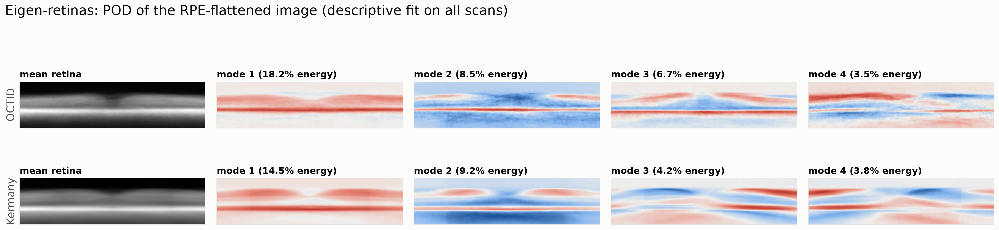

The modes now look like anatomy (layer brightness, thickness, the foveal dip) instead of retina position.

| Task | Image-POD alone, best r (model) | v5 best | v5 best + image-POD r=50 | Paired Δ [95% CI], one-sided p |
|---|---|---|---|---|
| OCTID CSR/DR/MH (500x750) | 0.696 [0.646, 0.755] (r=100, LR) | 0.872 [0.833, 0.911] | 0.881 [0.855, 0.924] | +0.015 [-0.010, +0.041], p = 0.141 |
| OCTDL 7-class | 0.439 [0.377, 0.479] (r=25, LR) | 0.669 [0.605, 0.723] | 0.664 [0.606, 0.720] | -0.002 [-0.015, +0.010], p = 0.637 |
| OCTDL 6 diseases | 0.423 [0.357, 0.469] (r=10, LR) | 0.653 [0.589, 0.722] | 0.634 [0.558, 0.690] | -0.029 [-0.061, -0.005], p = 0.992 |
| Kermany 4-class | 0.537 [0.509, 0.558] (r=50, LightGBM) | 0.695 [0.671, 0.718] | 0.698 [0.678, 0.724] | +0.006 [-0.004, +0.015], p = 0.123 |
| Kermany CNV/DME/DRUSEN | 0.611 [0.578, 0.635] (r=25, LightGBM) | 0.731 [0.706, 0.765] | 0.731 [0.708, 0.765] | +0.001 [-0.013, +0.015], p = 0.456 |
| Kermany -> OCTDL (NORMAL/DME/AMD) | 0.546 [0.508, 0.584] (r=200, LR) | 0.709 [0.673, 0.743] | 0.693 [0.657, 0.730] | -0.017 [-0.036, +0.002], p = 0.963 |

*Source: `results/v6/image_pod_<task>.json`.*

**Reading.** The image modes alone are much weaker than the hand-crafted physics features, and adding them to v5 changes nothing significant (best case OCTID, p = 0.14; worst case OCTDL 6 diseases, −0.029). An honest negative: *a good coordinate frame makes POD interpretable, but the energetic image patterns are still not the diagnostic ones* (the v5 "energy ≠ information" lesson again).

### 11.2 POD residual: ROM-based defect detection

In NDT, a part is flagged when it cannot be explained by a model of good parts. Here: fit POD on **healthy training eyes only**, then for a new scan

$$
e(x) = \frac{\lVert x - \bar x - V_r V_r^T (x - \bar x) \rVert^2}{\lVert x - \bar x \rVert^2}
$$

is the fraction of its deviation from the average healthy retina that the healthy modes cannot rebuild. The residual image $x - \hat x$ shows *where* it departs.

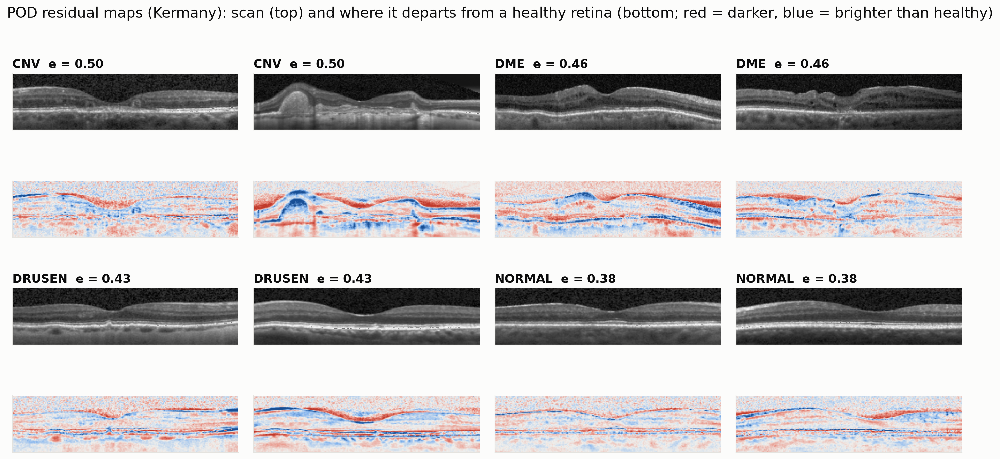

| NORMAL vs ABNORMAL | AUROC r=10 | AUROC r=25 [95% CI] | AUROC r=50 |
|---|---|---|---|
| OCTDL 7-class | 0.665 | 0.696 [0.659, 0.731] | 0.717 |
| Kermany 4-class | 0.660 | 0.700 [0.673, 0.732] | 0.720 |
| Kermany healthy -> OCTDL (NORMAL vs ABNORMAL) | 0.659 | 0.691 [0.656, 0.724] | 0.708 |

*Source: `results/v6/residual_auroc.json`.*

| Task | v5 best + e(x) | Paired Δ vs v5 best |
|---|---|---|
| OCTID CSR/DR/MH (500x750) | 0.875 [0.846, 0.920] | +0.011 [+0.000, +0.027], p = 0.049 |
| OCTDL 7-class | 0.666 [0.607, 0.724] | +0.000 [-0.007, +0.008], p = 0.476 |
| OCTDL 6 diseases | 0.649 [0.584, 0.716] | -0.005 [-0.014, +0.004], p = 0.859 |
| Kermany 4-class | 0.699 [0.673, 0.721] | +0.003 [-0.004, +0.010], p = 0.202 |
| Kermany CNV/DME/DRUSEN | 0.729 [0.704, 0.762] | -0.003 [-0.010, +0.005], p = 0.746 |
| Kermany -> OCTDL (NORMAL/DME/AMD) | 0.704 [0.667, 0.739] | -0.005 [-0.018, +0.006], p = 0.821 |

*Source: `results/v6/residual_clf.json`.*

**Reading.** With no disease labels at all, e(x) separates healthy from diseased eyes with AUROC ≈ 0.70, and the same healthy basis transfers to the other scanner almost unchanged (0.691). It is a useful, explainable screening signal, but as one more feature next to 171 physics features it is redundant.

### 11.3 Hybrid: frozen deep features + physics

A frozen network (never trained on our labels) turns each tile into an embedding: ResNet-18 (ImageNet, 512 numbers) or DINOv2-S (self-supervised, 384 numbers). Inside each training fold we reduce it with PCA to 64 numbers and concatenate

$$
z = [\,\text{PCA}_{64}(\text{embedding}),\; \text{v5 physics features (171)},\; \text{ROM: image-POD } a_{1..50},\; \log e(x)\,] \;\to\; \text{soft vote (LR + LightGBM + SVM)}
$$

**Which hybrid is the headline.** The DINOv2-S hybrid was chosen as "the v6 model" *before* seeing any result. After the runs, the ResNet-18 hybrid won or tied on 4 of 6 tasks, so it is the headline model in this README, the summary and the deck. That choice was made after seeing the results; both hybrids and both embedding-only models are reported in every table so the reader can judge. The fine-tuned CNN (`v6_cnn.py`, same recipe as `cnn_baseline.py`) was re-run on the identical folds so every comparison is paired.

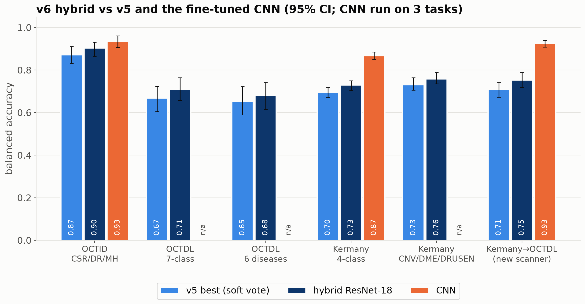

Balanced accuracy [95% CI], mean of 3 seeds (CNN: seed-0 folds only). Embedding-only rows are the ablation.

| Model | OCTID CSR/DR/MH | OCTDL 7-class | OCTDL 6 dis. | Kermany 4-class | Kermany 3 dis. | Kermany → OCTDL |
|---|---|---|---|---|---|---|
| v5 best (soft vote) | 0.872 [0.833, 0.911] | 0.669 [0.605, 0.723] | 0.653 [0.589, 0.722] | 0.695 [0.671, 0.718] | 0.731 [0.706, 0.765] | 0.709 [0.673, 0.743] |
| ResNet-18 embedding only | 0.908 [0.884, 0.948] | 0.671 [0.603, 0.709] | 0.649 [0.585, 0.704] | 0.695 [0.670, 0.715] | 0.718 [0.701, 0.751] | 0.737 [0.702, 0.770] |
| DINOv2-S embedding only | 0.865 [0.831, 0.908] | 0.600 [0.541, 0.649] | 0.581 [0.520, 0.655] | 0.683 [0.668, 0.711] | 0.722 [0.691, 0.742] | 0.683 [0.647, 0.717] |
| **hybrid ResNet-18 (headline)** | 0.904 [0.865, 0.932] | 0.708 [0.657, 0.764] | 0.682 [0.616, 0.741] | 0.730 [0.704, 0.750] | 0.759 [0.735, 0.789] | 0.753 [0.719, 0.789] |
| hybrid DINOv2-S | 0.899 [0.864, 0.933] | 0.688 [0.632, 0.748] | 0.669 [0.602, 0.736] | 0.734 [0.715, 0.759] | 0.763 [0.740, 0.791] | 0.729 [0.694, 0.766] |
| CNN (fine-tuned ResNet-18) | 0.935 [0.905, 0.961] | n/a | n/a | 0.867 [0.851, 0.885] | n/a | 0.925 [0.908, 0.940] |

Paired differences on identical folds (seed 0), 95% patient-bootstrap CI and one-sided p (source `results/v6/ablation.json`):

| Task | ResNet-18 hybrid − ResNet-18 embedding | ResNet-18 hybrid − v5 | ResNet-18 hybrid − CNN | DINOv2-S hybrid − DINOv2-S embedding | DINOv2-S hybrid − v5 |
|---|---|---|---|---|---|
| OCTID CSR/DR/MH | -0.018 [-0.062, +0.024], p = 0.779 | +0.025 [+0.001, +0.050], p = 0.020 | -0.036 [-0.076, +0.003], p = 0.966 | +0.028 [-0.020, +0.075], p = 0.116 | +0.025 [-0.004, +0.054], p = 0.045 |
| OCTDL 7-class | +0.051 [+0.018, +0.096], p = 0.002 | +0.045 [+0.022, +0.073], p = 0.000 | n/a | +0.098 [+0.066, +0.130], p = 0.000 | +0.024 [+0.006, +0.044], p = 0.005 |
| OCTDL 6 dis. | +0.035 [-0.004, +0.077], p = 0.040 | +0.028 [-0.007, +0.059], p = 0.051 | n/a | +0.080 [+0.047, +0.119], p = 0.000 | +0.014 [-0.006, +0.035], p = 0.085 |
| Kermany 4-class | +0.034 [+0.014, +0.053], p = 0.001 | +0.032 [+0.018, +0.045], p = 0.000 | -0.141 [-0.162, -0.120], p = 1.000 | +0.047 [+0.026, +0.069], p = 0.000 | +0.043 [+0.028, +0.057], p = 0.000 |
| Kermany 3 dis. | +0.036 [+0.013, +0.059], p = 0.002 | +0.027 [+0.011, +0.043], p = 0.001 | n/a | +0.050 [+0.028, +0.071], p = 0.000 | +0.031 [+0.014, +0.048], p = 0.001 |
| Kermany → OCTDL | +0.016 [-0.024, +0.057], p = 0.221 | +0.044 [+0.021, +0.067], p = 0.000 | -0.172 [-0.206, -0.138], p = 1.000 | +0.046 [+0.011, +0.082], p = 0.006 | +0.020 [-0.004, +0.046], p = 0.061 |

Grouped permutation importance of the headline hybrid ResNet-18 hybrid, **measured on OCTID CSR/DR/MH only** (drop in balanced accuracy when a group is permuted in held-out folds). Groups are labelled by family: *physics* = hand-crafted v5 features, *ROM* = the v6 image-level reduced-order model, *deep* = the frozen embedding. Importance shows how much the fitted model **relies** on a group, not how much accuracy the group **adds**; the ablation above answers that.

| Rank | Group | Importance |
|---|---|---|
| 1 | deep: ResNet-18 embedding (PCA 64) | 0.0558 |
| 2 | physics: NDT (pulse-echo) | 0.0456 |
| 3 | physics: disease-specific (thickness, fluid, gap, RPE) | 0.0390 |
| 4 | physics: texture: rpe band | 0.0316 |
| 5 | physics: texture: choroid band | 0.0078 |
| 6 | physics: texture: inner band | 0.0067 |
| 7 | physics: texture: outer band | 0.0052 |
| 8 | ROM: image-POD (50 modes) | 0.0022 |
| 9 | ROM: POD residual e(x) | 0.0000 |
| 10 | physics: boundary fractal | -0.0019 |

*Source: `results/v6/hybrid_<task>.json`, `cnn_<task>.json`, `ablation.json`, `hybrid_importance.json` (DINOv2-S hybrid: `hybrid_importance_dinov2s.json`).*

**Ablation: what does the physics add?** The embedding-only rows answer this directly. With the same frozen ResNet-18, adding the physics + ROM features is significantly better on OCTDL 7-class, Kermany 4-class, Kermany 3-disease (+0.03 to +0.05), and the CI includes zero on OCTID, OCTDL 6-disease, the new scanner. On OCTID the embedding alone is already as good (-0.018 [-0.062, +0.024], p = 0.779). The DINOv2-S embedding is weaker on its own, so physics adds more there.

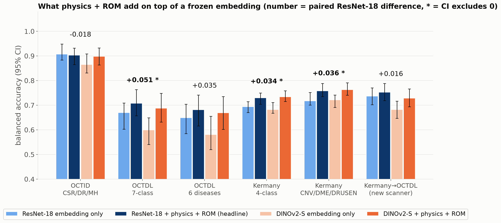

**Importance is not accuracy.** Grouped permutation importance was measured on OCTID CSR/DR/MH only. For the ResNet-18 hybrid it ranks the deep embedding first and the NDT pulse-echo group second; the two ROM groups (image-POD, e(x)) have almost no weight. Importance shows how much the *fitted* model relies on a group, not how much accuracy the group adds: on OCTID the physics features are heavily used, yet removing them does not lower accuracy, because the embedding carries the same information.

**Acceptance check (stated plainly).** The target was to match the fine-tuned CNN within the CI on OCTID CSR/DR/MH while keeping physics in the top importances. The ResNet-18 hybrid's paired difference to the CNN is -0.036 [-0.076, +0.003], p = 0.966: the interval just includes zero, but the point estimate is 0.036 lower, and on Kermany (-0.141 [-0.162, -0.120], p = 1.000) and on the new scanner (-0.172 [-0.206, -0.138], p = 1.000) the CNN is clearly better. Physics groups rank 2nd to 4th, behind the embedding. **The hybrid does not close the gap to the CNN; it narrows it while staying partly explainable.**

### 11.4 Does the CNN look where the physics looks?

Grad-CAM weights the last convolutional feature maps $A_c$ by the average gradient of the class score, $\text{CAM} = \text{ReLU}(\sum_c w_c A_c)$, $w_c = \overline{\partial y / \partial A_c}$. We map each CAM onto the flattened retina with the same column shifts as `retina.layers.flatten`, sum it inside each band, and compare with the physics model's per-band permutation importance.

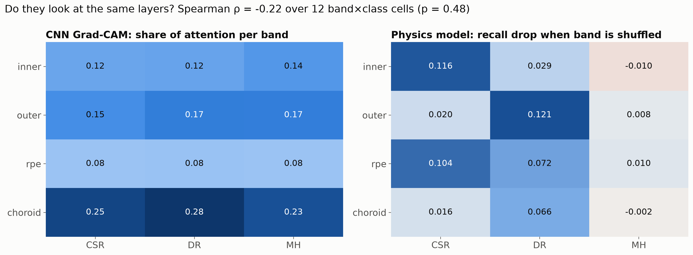

| Band | CAM share CSR | CAM share DR | CAM share MH | physics recall drop CSR | physics recall drop DR | physics recall drop MH |
|---|---|---|---|---|---|---|
| inner | 0.120 | 0.122 | 0.137 | 0.116 | 0.029 | -0.010 |
| outer | 0.148 | 0.169 | 0.168 | 0.020 | 0.121 | 0.008 |
| rpe | 0.081 | 0.082 | 0.081 | 0.104 | 0.072 | 0.010 |
| choroid | 0.251 | 0.275 | 0.233 | 0.016 | 0.066 | -0.002 |

Spearman ρ over the 12 band × class cells: -0.22 (p = 0.48). *Source: `results/v6/gradcam_octid_dis750.json`.*

**Reading.** No agreement (ρ = -0.22). The CNN spends about a quarter of its attention in the choroid band, where the physics model finds little; the physics model uses the inner retina for CSR and the outer retina for DR. Either the CNN uses choroidal/shadowing cues the hand-crafted features miss, or it uses context we would not call pathology. This is a question, not an answer, and a good one for future work.

### 11.5 Cross-scanner robustness (Kermany → OCTDL)

Two NDT-style corrections: a **reference block** (z-score every input block with k = 30 healthy eyes of the target scanner, removed from the test set, 10 draws) and **speckle-matched test-time augmentation** (blur the test scan with σ ∈ {0, 0.5, 1} px, recompute *every* feature, average the probabilities).

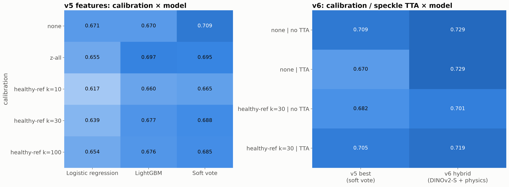

| Model | Calibration | TTA | Balanced acc | Recall NORMAL / DME / AMD |
|---|---|---|---|---|
| v5 best (soft vote) | none | no TTA | 0.709 | 0.79 / 0.55 / 0.78 |
| v5 best (soft vote) | none | TTA | 0.670 | 0.66 / 0.50 / 0.85 |
| v5 best (soft vote) | healthy-ref k=30 | no TTA | 0.682 ± 0.015 | 0.72 / 0.75 / 0.57 |
| v5 best (soft vote) | healthy-ref k=30 | TTA | 0.705 ± 0.018 | 0.75 / 0.74 / 0.62 |
| v6 hybrid (ResNet-18 + physics) | none | no TTA | 0.753 | 0.88 / 0.62 / 0.76 |
| v6 hybrid (ResNet-18 + physics) | none | TTA | 0.753 | 0.80 / 0.64 / 0.82 |
| v6 hybrid (ResNet-18 + physics) | healthy-ref k=30 | no TTA | 0.730 ± 0.018 | 0.79 / 0.80 / 0.60 |
| v6 hybrid (ResNet-18 + physics) | healthy-ref k=30 | TTA | 0.752 ± 0.018 | 0.82 / 0.80 / 0.64 |
| v6 hybrid (DINOv2-S + physics) | none | no TTA | 0.729 | 0.81 / 0.58 / 0.79 |
| v6 hybrid (DINOv2-S + physics) | none | TTA | 0.729 | 0.73 / 0.63 / 0.83 |
| v6 hybrid (DINOv2-S + physics) | healthy-ref k=30 | no TTA | 0.701 ± 0.015 | 0.77 / 0.70 / 0.63 |
| v6 hybrid (DINOv2-S + physics) | healthy-ref k=30 | TTA | 0.719 ± 0.015 | 0.77 / 0.73 / 0.66 |

Paired tests: v6 hybrid (ResNet-18 + physics) | none | no TTA vs v5 best (soft vote) | none | no TTA: +0.044 [+0.021, +0.067], p = 0.000; v6 hybrid (DINOv2-S + physics) | none | no TTA vs v5 best (soft vote) | none | no TTA: +0.020 [-0.004, +0.046], p = 0.061; v5 best (soft vote) | none | TTA vs no TTA: -0.039 [-0.060, -0.021], p = 1.000; v6 hybrid (ResNet-18 + physics) | none | TTA vs no TTA: -0.000 [-0.020, +0.019], p = 0.524; v6 hybrid (DINOv2-S + physics) | none | TTA vs no TTA: +0.000 [-0.017, +0.019], p = 0.501; v6 hybrid (ResNet-18 + physics) | none | no TTA vs CNN: -0.172 [-0.206, -0.138], p = 1.000; v6 hybrid (DINOv2-S + physics) | none | no TTA vs CNN: -0.197 [-0.232, -0.159], p = 1.000

*Source: `results/v6/cross.json`.*

**Reading.** The ResNet-18 hybrid is the best non-CNN model on the new scanner (0.753, significantly better than v5: +0.044 [+0.021, +0.067], p = 0.000), but the CNN reaches 0.925. Calibration with healthy eyes trades AMD recall for DME recall and does not raise balanced accuracy; TTA leaves the hybrids unchanged and hurts v5. **DME recall is still the weak point.**

### 11.6 Conformal triage on the headline hybrid

| Task | Target | Coverage per class | Mean set size (v5) | Singleton rate (v5) | Singleton accuracy (v5) |
|---|---|---|---|---|---|
| OCTDL triage NORMAL vs ABNORMAL | 0.95 | ABNORMAL 0.945, NORMAL 0.961 | 1.04 (1.08) | 0.95 (0.92) | 0.947 (0.952) |
| OCTDL triage NORMAL vs ABNORMAL | 0.90 | ABNORMAL 0.892, NORMAL 0.919 | 0.96 (0.98) | 0.95 (0.96) | 0.940 (0.931) |
| Kermany triage NORMAL vs ABNORMAL | 0.95 | ABNORMAL 0.941, NORMAL 0.943 | 1.17 (1.27) | 0.83 (0.73) | 0.929 (0.921) |
| Kermany triage NORMAL vs ABNORMAL | 0.90 | ABNORMAL 0.889, NORMAL 0.894 | 1.04 (1.09) | 0.96 (0.91) | 0.886 (0.878) |
| OCTID CSR/DR/MH (500x750) | 0.95 | CSR 1.000, DR 0.975, MH 0.936 | 2.01 (2.10) | 0.19 (0.18) | 0.951 (0.948) |
| OCTID CSR/DR/MH (500x750) | 0.90 | CSR 0.897, DR 0.951, MH 0.887 | 1.14 (1.25) | 0.85 (0.75) | 0.910 (0.910) |
| Kermany CNV/DME/DRUSEN | 0.95 | CNV 0.952, DME 0.952, DRUSEN 0.952 | 1.78 (1.82) | 0.37 (0.33) | 0.910 (0.899) |
| Kermany CNV/DME/DRUSEN | 0.90 | CNV 0.903, DME 0.899, DRUSEN 0.897 | 1.44 (1.53) | 0.60 (0.52) | 0.860 (0.841) |

*Source: `results/v6/conformal.json` (ResNet-18 hybrid; DINOv2-S hybrid in `conformal_dinov2s.json`; v5 values copied from `results/v5/conformal.json`).*

**Reading.** At a 0.95 target the ResNet-18 hybrid keeps 0.945 of diseased OCTDL eyes, just under the target and within one binomial standard error; at 0.90 and on the other tasks coverage sits on or near the target, as for v5. Because the hybrid is more accurate, the prediction sets are smaller on every task: fewer scans need a second opinion for the same guarantee. (DINOv2-S hybrid: `results/v6/conformal_dinov2s.json`.)

---

## 12. Presentation

[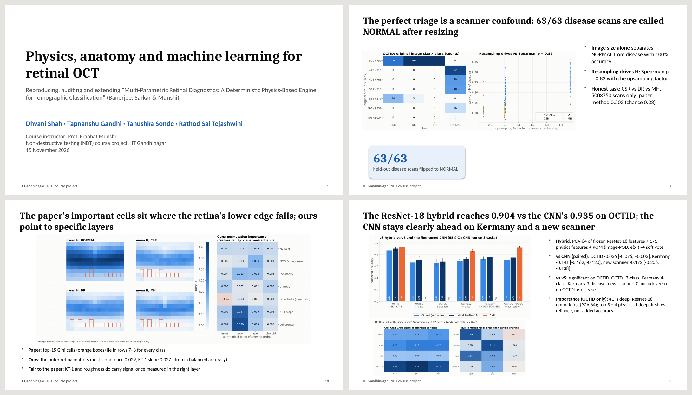](presentation/Retinal_OCT_Physics_ML.pptx)

- Deck: [`presentation/Retinal_OCT_Physics_ML.pptx`](presentation/Retinal_OCT_Physics_ML.pptx) (28 slides, 16:9, speaker notes on every slide), PDF: [`presentation/Retinal_OCT_Physics_ML.pdf`](presentation/Retinal_OCT_Physics_ML.pdf).
- Rebuild: `python make_figures.py && python make_deck.py --pdf`. `make_figures.py` reads only `results/` and writes `presentation/figures/*.png`; `make_deck.py` builds the deck with python-pptx.
- Every number on a slide is read from `results/` at build time and listed with its source file in [`presentation/numbers.json`](presentation/numbers.json) (figure values in `presentation/figures/figure_numbers.json`).

---

## 13. How we evaluate (and why)

| Practice | Why |
|---|---|
| **Patient-grouped** 5-fold CV (`StratifiedGroupKFold`), 3 repeats | Scans of one patient never sit in both train and test. Otherwise the model memorises the patient |
| **Balanced accuracy** $=\frac{1}{K}\sum_k \text{recall}_k$ | Plain accuracy rewards ignoring small classes |
| **Cluster bootstrap 95% CI** | Resample *patients* 1000×; shows how much the number could move with different patients |
| **Paired bootstrap test** | Two models on identical folds; bootstrap the *difference* to get a CI and one-sided p |
| **Grouped permutation importance** | Shuffle a whole feature group in held-out folds and measure the drop in balanced accuracy. More honest than Gini importance |
| **Everything learned inside the fold** | Imputation, scaling, POD modes and conformal quantiles never see test scans |
| **De-confounded tasks** | OCTID disease-only on 500×750 scans only. Cross-scanner tests on Kermany → OCTDL |

---

## 14. Code map

```
retina/
  preprocess.py     paper Sec. 2: white-wedge mask, crop, 750x500, 150 cells
  features.py       paper Sec. 3: KT-1 slope S, NMSID Hurst H
  layers.py         v2: axial resampling, ILM/RPE tracing, flattening, bands, sectors
  features_v2.py    v2: band x sector texture (H, lacunarity, coherence, ...), disease features
  features_ndt.py   v3: attenuation, interface contrast, half-max sizing, shadowing, CNR, speckle
  fractal.py        v4: box / divider / NMSID estimators, known-answer shapes, boundary fractals
  evaluation.py     feature sets, models, grouped CV, bootstrap CIs, permutation importance
  rom.py            v5: FieldPOD transformer (per-field POD, fitted in-fold)
  ensemble.py       v5: LR, LightGBM, RBF-SVM, soft vote
  conformal.py      v5: class-conditional split conformal prediction
  plotstyle.py      shared figure style
  image_rom.py      v6: flattened-retina tiles, ImagePOD (randomized SVD, residual e(x))
  hybrid.py         v6: HybridClassifier (POD / residual / PCA fitted inside fit())
  v6data.py v6eval.py v6run.py   v6: tasks, identical folds, OOF CSVs, paired tests
v5_rom.py  v5_ensemble.py  v5_conformal.py  v5_harmonize.py  v5_summary.py
v6_tiles.py v6_embed.py v6_image_pod.py v6_residual.py v6_cnn.py v6_hybrid.py v6_gradcam.py
v6_cross.py v6_conformal.py v6_ablation.py v6_baselines.py v6_figdata.py v6_paper_claims.py v6_summary.py
make_figures.py make_deck.py   presentation (figures from results/ only, python-pptx deck)
tests/test_no_leak.py          fails if any transformer is fitted on test rows
CLAUDE_CODE_PROMPT.md   step-by-step v6 plan (image-level ROM, hybrid deep + physics)
results/                v1  (paper reproduction)
results/v2 ... v6       per-stage outputs (CSV/JSON/PNG/MD/NPZ)
```

---

## 15. Limitations and next steps

**Limitations**
- OCTID has no patient IDs; each image is treated as its own patient (could be optimistic if one patient has several images).
- All datasets are display JPEGs (log-compressed, contrast-stretched), so NDT quantities are *relative*, not physical units.
- Lateral pixel spacing is not stored; 6 mm / 512 columns is assumed where µm sizes are quoted.
- The v5 ensemble gains are small and not significant on OCTID or OCTDL. The robust win is on Kermany and across scanners.
- The CNN was run on 3 of the 6 tasks (OCTID CSR/DR/MH, Kermany 4-class, Kermany → OCTDL) to stay inside a 2-hour GPU budget, with one seed (seed-0 folds).
- The v6 hybrid relies on frozen ImageNet (ResNet-18) and self-supervised (DINOv2-S) backbones that were never tuned on OCT.
- Everything is 2-D. Disease is 3-D (the paper's "3D anisotropic" future work needs volume data, which none of these datasets provide).

**Next steps after v6**
1. Find out what the CNN sees in the choroid band (Section 11.4): occlusion tests per band, or choroid-specific NDT features (shadowing, vessel lumen texture).
2. Scanner robustness needs more than affine calibration: train on two scanners and test on the third, or learn a scanner-invariant tile representation.
3. Fine-tune the hybrid's backbone (with physics features kept as a parallel branch) and re-check the importance ranking.
4. 3-D volumes (the paper's "3D anisotropic" idea) would let POD and the NDT features use the full scan, not one B-scan.

---

## 16. Glossary

| Term | Meaning |
|---|---|
| A-scan / B-scan | One depth profile / a 2-D cross-section of A-scans |
| ILM, RPE | Top surface of the retina / bright pigment layer at its back |
| Hurst exponent H | Slope of log(roughness) vs log(distance); low = rough |
| KT-1 slope | Slope of $1/N_{\max}$ vs filter curvature; Munshi's tomographic error indicator |
| Lacunarity | How "gappy" a texture is at a given box size |
| Structure-tensor coherence | How strongly a patch has one dominant orientation (layering) |
| POD / PCA | Find orthogonal modes that capture the most variance (energy) of a set of fields |
| Energy $E(r)$ | Fraction of total variance captured by the first $r$ modes |
| Balanced accuracy | Mean of per-class recalls |
| Conformal prediction | Turns scores into label *sets* with guaranteed coverage $\ge 1-\alpha$ |
| Confound | A non-medical factor (here: scanner) that differs between classes and lets a model cheat |
| Eigen-retina | A POD mode of the flattened retina image |
| POD residual e(x) | Fraction of a scan's deviation that the healthy-eye POD modes cannot rebuild |
| Grad-CAM | Heat map of where a CNN's class score depends on the image |
| MAPOD, $a_{90/95}$ | Probability-of-detection curve from simulated flaws; smallest size found 90% of the time with 95% confidence |

---

## 17. References

- Banerjee R., Sarkar S., Munshi P. *Multi-Parametric Retinal Diagnostics: A Deterministic Physics-Based Engine for Tomographic Classification.* IIT Gandhinagar.
- Munshi P., Rathore R.K.S., Ram K.S., Kalra M.S. *Error estimates for tomographic inversion.* Inverse Problems 7(3), 399–408, 1991.
- Athe P., Shakya S., Munshi P., Luke A., Mewes D. *Characterization of multiphase flow in bubble columns using KT-1 signature and fractal dimension.* Flow Meas. Instrum. 33, 122–137, 2013.
- Mandelbrot B.B. *The Fractal Geometry of Nature.* W.H. Freeman, 1982.
- Gholami P. et al. *OCTID: Optical Coherence Tomography Image Database.* arXiv:1812.07056.
- Kermany D. et al. *Identifying medical diagnoses and treatable diseases by image-based deep learning.* Cell 172(5), 2018.
- Kulyabin M. et al. *OCTDL: Optical Coherence Tomography Dataset for Image-Based Deep Learning Methods.* Scientific Data 11, 2024.
- Berkooz G., Holmes P., Lumley J.L. *The proper orthogonal decomposition in the analysis of turbulent flows.* Annu. Rev. Fluid Mech. 25, 539–575, 1993.
- Breiman L. *Random Forests.* Machine Learning 45, 5–32, 2001.
- Ke G. et al. *LightGBM: A highly efficient gradient boosting decision tree.* NeurIPS 2017.
- Vovk V., Gammerman A., Shafer G. *Algorithmic Learning in a Random World.* Springer, 2005.
- Angelopoulos A.N., Bates S. *A gentle introduction to conformal prediction and distribution-free uncertainty quantification.* arXiv:2107.07511, 2021.
- Johnson W.E., Li C., Rabinovic A. *Adjusting batch effects in microarray expression data using empirical Bayes methods* (ComBat). Biostatistics 8(1), 2007.
- MIL-HDBK-1823A. *Nondestructive Evaluation System Reliability Assessment.* US DoD, 2009.
- Halko N., Martinsson P.G., Tropp J.A. *Finding structure with randomness: probabilistic algorithms for constructing approximate matrix decompositions.* SIAM Review 53(2), 2011.
- Oquab M. et al. *DINOv2: Learning robust visual features without supervision.* TMLR, 2024.
- He K. et al. *Deep residual learning for image recognition.* CVPR 2016.
- Selvaraju R.R. et al. *Grad-CAM: Visual explanations from deep networks via gradient-based localization.* ICCV 2017.
